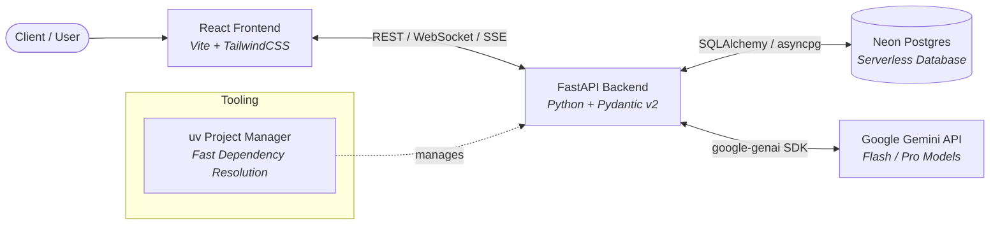

# Preferred Technology Stack

## 1. Overview & Architecture
This document defines the core technology stack, supporting libraries, and development conventions selected for the hackathon. The stack is optimized for **maximum iteration speed**, **type safety**, **rapid deployment**, and **high-performance AI capabilities**.



---

## 2. Core Stack Breakdown

### Frontend: React
- **Runtime / Bundler:** [React](https://react.dev/) + [Vite](https://vitejs.dev/) (fast HMR, lightweight build setup)
- **Language:** TypeScript / JavaScript (ESNext)
- **Styling:** Tailwind CSS or Modern Modular CSS (rapid prototyping of responsive, polished UI)
- **UI & Icons:** Lucide React, Radix UI / headless primitives
- **Data Fetching & State:** TanStack Query (React Query) or Axios / Fetch API, Zustand or React Context for global state
- **Key Advantages:** Rich ecosystem, reusable component architectures, instant hot-reloading.

### Backend: FastAPI
- **Framework:** [FastAPI](https://fastapi.tiangolo.com/) (Python 3.11+)
- **Server:** Uvicorn (ASGI)
- **Validation & Serialization:** Pydantic v2 (strict request/response validation, automatic JSON schema generation)
- **API Documentation:** Automatic interactive Swagger (`/docs`) and ReDoc (`/redoc`)
- **Key Advantages:** Asynchronous I/O (`async`/`await`), native WebSocket and SSE streaming support, auto-generated OpenAPI documentation.

### Database: Neon (PostgreSQL)
- **Database Engine:** [Neon Serverless Postgres](https://neon.tech/)
- **ORM / Query Builder:** SQLAlchemy 2.0 (Async) or SQLModel
- **Database Driver:** `asyncpg` / `psycopg3`
- **Key Advantages:**
  - Instant serverless provisioning (zero infrastructure overhead).
  - Database branching (create branch databases per PR or feature branch without altering main data).
  - Native PostgreSQL compatibility (support for pgvector, JSONB, full-text search).

### LLM API: Google Gemini
- **SDK:** Official `google-genai` Python SDK
- **Recommended Models:**
  - `gemini-2.0-flash` / `gemini-1.5-flash`: Ultra-fast inference, high throughput, ideal for real-time app interactions and chat loops.
  - `gemini-1.5-pro`: Deep multimodal reasoning, complex problem solving, large-scale context processing.
- **Key Features Utilized:**
  - Structured Outputs (enforcing Pydantic schemas on model outputs).
  - Multi-turn Conversations & System Instructions.
  - Streaming responses via Server-Sent Events (SSE).
  - Multimodal inputs (text, image, audio, document analysis).

### Project & Package Manager: `uv` (Astral)
- **Tool:** [`uv`](https://github.com/astral-sh/uv)
- **Role:** Python package management, virtual environment isolation, and project execution.
- **Key Advantages:**
  - 10-100x faster than traditional `pip` / `poetry` installations.
  - Built-in virtual environment orchestration (`uv venv`, `uv pip`, `uv run`).
  - Single-tool replacement for `pip`, `pip-tools`, `virtualenv`, and `poetry`.

---

## 3. Recommended Project Structure

```text
hackathon-project/
├── backend/
│   ├── app/
│   │   ├── api/             # API route handlers (endpoints)
│   │   ├── core/            # Config, security, database connections
│   │   ├── models/          # DB models & Pydantic schemas
│   │   ├── services/        # Business logic & Gemini LLM service
│   │   └── main.py          # FastAPI application entrypoint
│   ├── pyproject.toml       # Managed by uv
│   ├── requirements.txt     # (Optional) uv pip export
│   └── .env.example
├── frontend/
│   ├── src/
│   │   ├── assets/          # Static assets & images
│   │   ├── components/      # Reusable UI components
│   │   ├── hooks/           # Custom React hooks
│   │   ├── services/        # API client modules
│   │   ├── App.jsx / .tsx   # Main application component
│   │   └── index.css        # Core styles & Tailwind imports
│   ├── package.json
│   ├── vite.config.js
│   └── .env.example
├── docs/                    # Documentation & architecture notes
│   ├── team_skills.md
│   └── prefered_stacks.md
└── README.md
```

---

## 4. Quickstart Guide

### Backend Setup (`uv` + FastAPI)
```bash
# 1. Navigate to backend directory
cd backend

# 2. Create virtual environment using uv
uv venv

# 3. Activate virtual environment
# Windows:
.venv\Scripts\activate
# Linux/macOS:
source .venv/bin/activate

# 4. Install dependencies with uv
uv pip install fastapi uvicorn[standard] google-genai sqlalchemy asyncpg pydantic-settings python-dotenv

# 5. Run FastAPI dev server
uv run uvicorn app.main:app --reload --port 8000
```

### Frontend Setup (React + Vite)
```bash
# 1. Navigate to frontend directory
cd frontend

# 2. Install dependencies
npm install

# 3. Start development server
npm run dev
```

---

## 5. Environment Variables Template

Create `.env` in both `backend/` and `frontend/` directories:

### Backend `.env`
```env
# Application
PROJECT_NAME="Hackathon App"
ENV="development"
DEBUG=True

# Neon Postgres Database Connection
DATABASE_URL="postgresql+asyncpg://<username>:<password>@<neon-hostname>/<dbname>?sslmode=require"

# Google Gemini API
GEMINI_API_KEY="your-gemini-api-key"

# CORS Configuration
CORS_ORIGINS=["http://localhost:5173", "http://127.0.0.1:5173"]
```

### Frontend `.env`
```env
VITE_API_BASE_URL="http://localhost:8000"
```

---

## 6. Hackathon Speed & Resilience Strategy
1. **Fast Prototyping with Swagger:** FastAPI automatically creates an interactive playground at `http://localhost:8000/docs`, allowing frontend developers to test backend APIs before frontend screens are fully built.
2. **Deterministic Outputs with Gemini:** Always configure Gemini calls using structured JSON schema / Pydantic responses to avoid unexpected string variations breaking the frontend.
3. **Database Branching:** Use Neon's branch creation feature for rapid experimentation without risking corrupting the shared development database.
4. **Zero-Lag Dependency Sync:** Use `uv pip sync` or `uv pip install` to eliminate long wait times when new packages are added by teammates.
