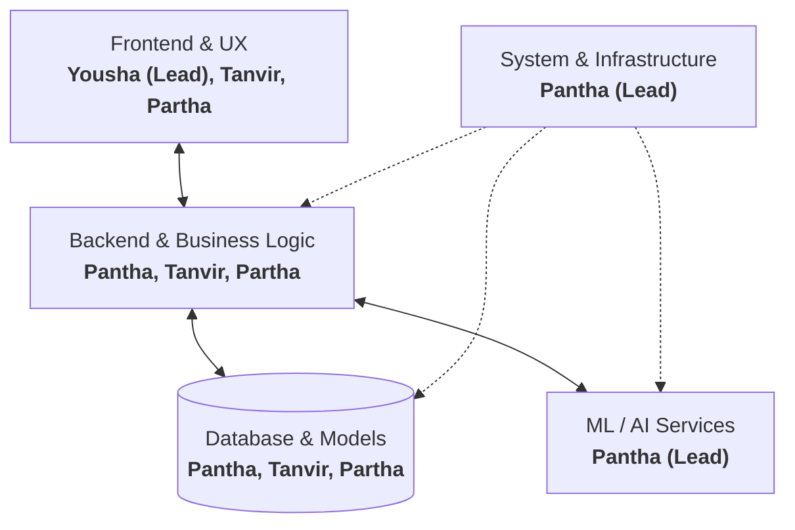

# Team Skills & Capability Matrix

## 1. Overview
This document outlines the core technical competencies, roles, and responsibility distributions for the hackathon team. With strong full-stack coverage, dedicated frontend leadership, machine learning capabilities, and systems engineering expertise, the team is structured for rapid prototyping and end-to-end delivery.

---

## 2. Team Roster

### Member 1: Pantha Protick
- **Core Domain:** Backend, Machine Learning (ML), Database, System
- **Primary Focus:**
  - AI/ML pipeline design, model integration, and inference APIs
  - Core system architecture, service reliability, and deployment
  - Database schema design, query optimization, and data layer logic
- **Hackathon Role:** ML & Systems Lead / Backend Engineer

### Member 2: Tanvir Hasan Ratul
- **Core Domain:** Backend, Frontend, Database
- **Primary Focus:**
  - Full-stack feature implementation (API endpoints to client views)
  - Business logic development and data layer integration
  - API integration, state management, and responsive UI components
- **Hackathon Role:** Full-Stack Engineer

### Member 3: Yousha Shahid
- **Core Domain:** Frontend
- **Primary Focus:**
  - User interface (UI) and user experience (UX) implementation
  - Component hierarchy, responsive layouts, styling, and design polish
  - Client-side routing, user flow interactions, and client-side performance
- **Hackathon Role:** Frontend Lead

### Member 4: Partha Sarathi Saha Tirtha
- **Core Domain:** Backend, Frontend, Database
- **Primary Focus:**
  - Full-stack end-to-end feature delivery
  - REST/GraphQL API development, authentication, and service orchestration
  - Frontend-to-backend integration and database operations
- **Hackathon Role:** Full-Stack Engineer

---

## 3. Skill & Coverage Matrix

| Domain / Competency | Pantha Protick | Tanvir Hasan Ratul | Yousha Shahid | Partha Sarathi Saha Tirtha | Coverage Status |
| :--- | :---: | :---: | :---: | :---: | :---: |
| **Frontend Development** | — | Primary / Full-Stack | Primary (Lead) | Primary / Full-Stack | Strong (3 Members) |
| **Backend Development** | Primary | Primary | — | Primary | Strong (3 Members) |
| **Database & Data Modeling** | Primary | Primary | — | Primary | Strong (3 Members) |
| **Machine Learning / AI** | Primary (Lead) | — | — | — | Dedicated Lead |
| **System Architecture / DevOps** | Primary (Lead) | — | — | — | Dedicated Lead |

---

## 4. Hackathon Workstream Allocation

### Workstream Breakdown
1. **Frontend & Experience (Lead: Yousha Shahid)**
   - **Collaborators:** Tanvir Hasan Ratul, Partha Sarathi Saha Tirtha
   - **Deliverables:** UI design system, interactive views, user onboarding, demo polish.
2. **Backend & Integration**
   - **Collaborators:** Pantha Protick, Tanvir Hasan Ratul, Partha Sarathi Saha Tirtha
   - **Deliverables:** Core API routes, authentication/session management, integration glue.
3. **Machine Learning & Intelligence (Lead: Pantha Protick)**
   - **Deliverables:** Model selection, prompt engineering/fine-tuning, inference service pipelines.
4. **Data Management & Persistence**
   - **Collaborators:** Pantha Protick, Tanvir Hasan Ratul, Partha Sarathi Saha Tirtha
   - **Deliverables:** Database setup, schema migrations, seed scripts for rapid testing.
5. **System Architecture & Deployment (Lead: Pantha Protick)**
   - **Deliverables:** Local environment orchestration, build pipelines, hosting, demo resilience.

---

## 5. Team Workflow & Best Practices
- **Contract-First Development:** Finalize API and data payload contracts early so Frontend and Backend teams can develop in parallel using mock data.
- **Continuous Integration for Demo:** Maintain a deployable main branch with functional end-to-end features rather than waiting for late integration.
- **Fast Handoffs:** Use shared schema definitions and automated type generation (if applicable) between frontend and backend services.
